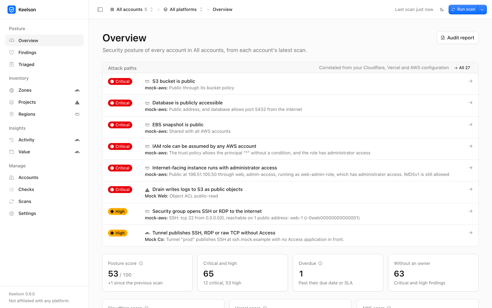
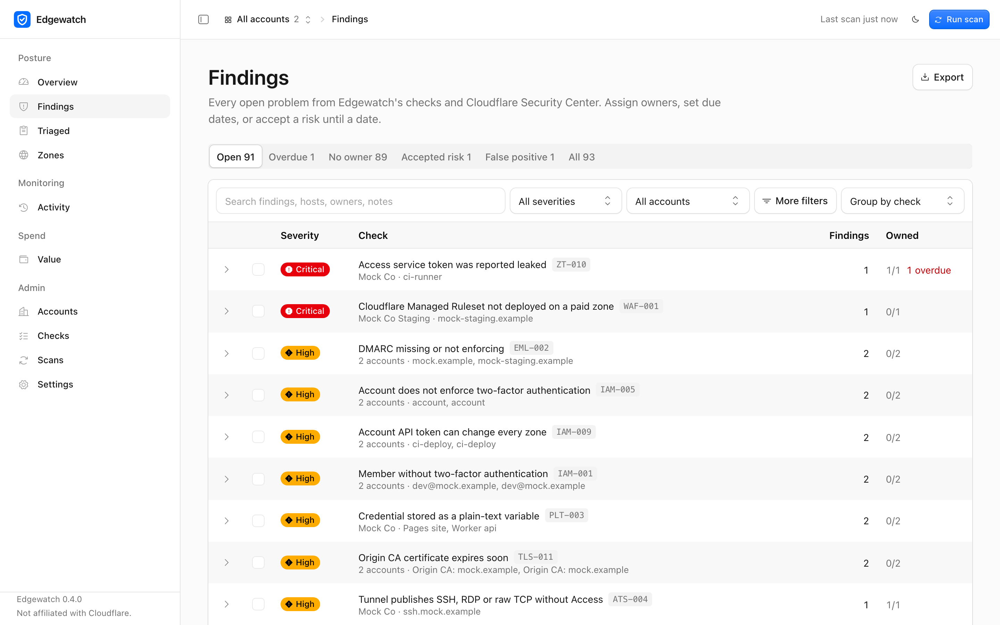
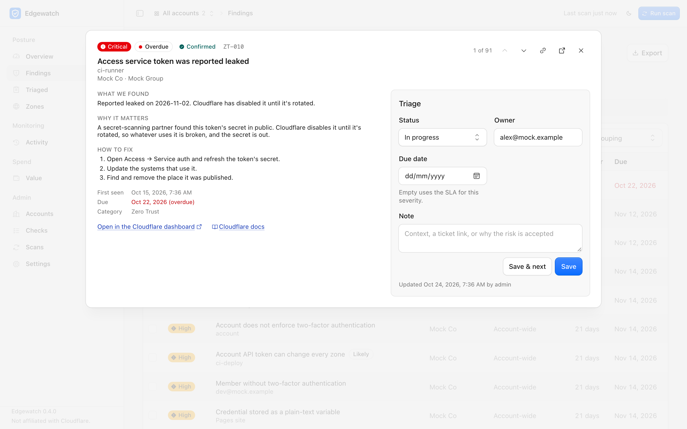
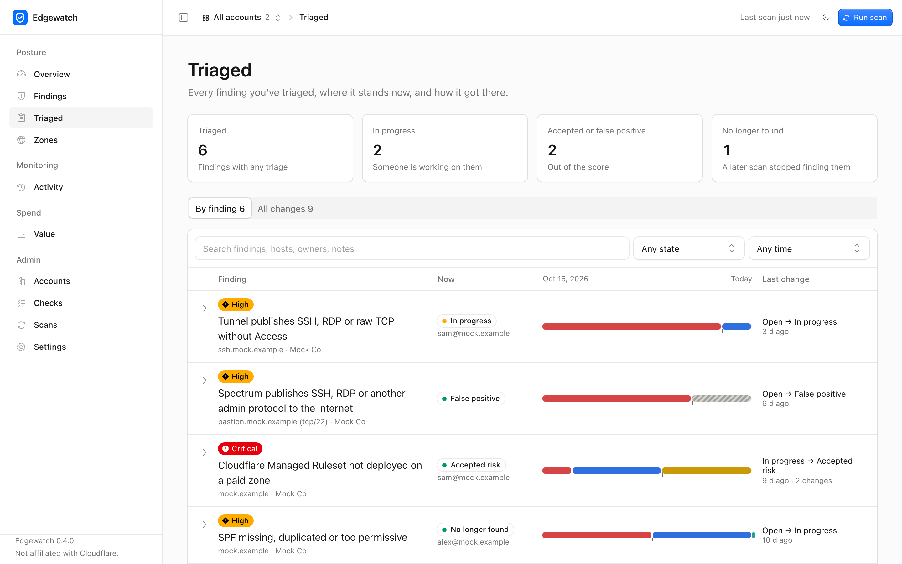
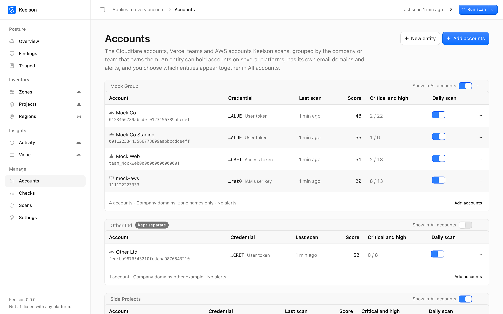

<p align="center">
  
</p>

<h1 align="center">Keelson</h1>

<p align="center">
  <strong>Security posture tracking for Cloudflare, Vercel and AWS.</strong><br>
  Read-only checks across DNS, WAF, TLS, Zero Trust, email, live traffic, deployments, secrets, IAM, storage and networks, and a place to triage every finding until it's fixed.<br>
</p>

<p align="center">
  <a href="https://github.com/r4reetik/keelson/actions/workflows/ci.yml"></a>
  <a href="https://github.com/r4reetik/keelson/actions/workflows/codeql.yml"></a>
  <a href="https://github.com/r4reetik/keelson/releases"></a>
  <a href="https://github.com/r4reetik/keelson/pkgs/container/keelson"></a>
  <a href="LICENSE"></a>
</p>

<p align="center">
  <a href="#quick-start">Quick start</a> ·
  <a href="docs/checks.md">All checks</a> ·
  <a href="docs/permissions.md">Permissions</a> ·
  <a href="docs/deployment.md">Deployment</a> ·
  <a href="CONTRIBUTING.md">Contributing</a>
</p>

<picture>
  <source media="(prefers-color-scheme: dark)" srcset="docs/images/overview-dark.png">
  
</picture>

Point Keelson at your Cloudflare accounts, your Vercel teams, your AWS accounts, or any mix of them, and it
scans them (one, or dozens across several companies), scores them, and tracks every finding until it's fixed:
who owns it, when it's due, and which risks were accepted and until when. It runs on your machine or your
server, and only ever reads. Use it for one platform or several: a company's accounts on every platform sit
together in one entity, and checks that span platforms catch what no single dashboard shows. More platforms
are planned.

> Keelson is an independent open-source project, not affiliated with or endorsed by Cloudflare, Vercel or AWS.
> Its interface is built with [Kumo](https://github.com/cloudflare/kumo), Cloudflare's open-source design system.

## Quick start

```bash
docker run -d --name keelson -p 127.0.0.1:4317:4317 \
  -v keelson-data:/data \
  -e KEELSON_PASSWORD='a-long-admin-password' \
  ghcr.io/r4reetik/keelson:0.9
```

That's the whole install: Keelson ships as this one image, for Intel and Arm, and needs nothing but Docker. Open
http://localhost:4317, sign in with the password, choose a platform (Cloudflare, Vercel or AWS), paste its token or
access key, pick the accounts or teams it should scan, and the first scans run. `127.0.0.1:` keeps it reachable from
this machine only; to run it for a team, see [below](#run-it-for-a-team-docker).

## What it checks

### Cloudflare

Its own checks, plus every insight from Cloudflare Security Center, imported and
de-duplicated against those checks. Many of them correlate data that no single Cloudflare
screen shows together, so they find problems a settings review or Security Center won't. Some go
further and check configuration against the last week of traffic from Cloudflare's analytics:
managed rules that log attacks without blocking them, `.env` files being served, plain-HTTP APIs.

| Area | Examples |
|---|---|
| Attack surface | Proxied origins whose IP is published by another record, SPF or MX; origins reachable without Cloudflare; admin tools (Grafana, n8n, Jenkins…) with no Access in front; tunnels or Spectrum publishing SSH or RDP; subdomain takeovers confirmed with a live check; lame NS delegations |
| Traffic | From the last 7 days of analytics: managed rules overridden to log while matching attacks, attack-scored requests answered, leaked-password logins not stopped, `.env` or `/.git/` served, plain HTTP, TLS 1.0 clients, rules that never match, bots on login pages |
| Identity & access | Members without 2FA, too many Super Administrators, external members, 2FA not enforced; account API tokens with no IP restriction, no expiry, unused, or write access to every zone |
| Zero Trust | Access groups or policies open to everyone or a webmail domain, leaked service tokens, CORS with credentials, one-time PIN beside SSO, Gateway without TLS inspection or logging, WARP that users can switch off, broad private routes, outdated cloudflared, idle seats |
| TLS & HTTPS | SSL mode below Full (strict), TLS 1.0/1.1 (zone or per hostname), no HSTS, legacy ciphers, proxied hostnames no certificate covers, expiring edge, Origin CA, custom, client and mTLS certificates |
| WAF & bots | Managed rules not deployed or switched to log-only, exceptions keyed on a header anyone can send, IP Access allowlists for whole countries or networks, weakened DDoS protection, mTLS that nothing enforces, URL normalization off, malicious scripts found by Page Shield, secrets hard-coded in transform rules |
| DNS | Hostnames pointing at deleted tunnels, dangling CNAMEs to cloud resources (takeover risk), private IPs, stale records, DNS-only load balancers handing out origin IPs, DNSSEC off, no CAA |
| Email | Missing or permissive SPF, DMARC not enforcing, SPF over 10 lookups, weak DKIM keys, DMARC reports silently dropped, no MTA-STS, catch-all forwarding, failing senders in DMARC reports |
| Platform | Workers reachable on workers.dev, public R2 buckets, R2 CORS open to any site, credentials in plain-text Worker or Pages variables, public Pages previews |
| Monitoring | Missing notifications, failing Logpush jobs, insecure or failing alert webhooks, Access apps rejecting thousands of logins |
| Change risk | In the last 7 days: security rules turned off, Access policies widened, zone security settings lowered (who and when, from the audit log) |
| Cost & usage | Paid plans on zones with almost no traffic |

### Vercel

Teams on any plan, and personal (Hobby) accounts. Keelson reads environment variable names and types,
never their values.

| Area | Examples |
|---|---|
| Deployments | Preview deployments open to anyone, *.vercel.app production URLs that skip the custom domain, pull requests from forks deploying with your secrets, protection bypass secrets, deploy hooks, cron jobs anyone can trigger, previews that never expire |
| Secrets | Secrets Vercel itself flags as readable, keys and tokens stored as plain text, secrets with a `NEXT_PUBLIC_`/`VITE_` prefix shipped to browsers, production secrets shared with previews or downloaded to laptops by `vercel env pull`, credentials written into build commands, team-wide shared variables, no Sensitive policy on the team |
| Identity & access | SAML SSO or two-factor authentication not required, too many Owners, members outside company domains who can deploy, open invitations and requests to join, integrations that can change every project, access tokens that leaked, never expire or sit unused, the global OIDC issuer |
| WAF & bots | Firewall off, bot protection off on public sites, OWASP rules left in log mode, wide IP ranges that bypass the firewall, no rate limiting |
| DNS, TLS & monitoring | Domains about to lapse with auto-renew off, unverified project domains, expiring custom certificates, log drains writing public S3 objects or sending over HTTP, failing drains |
| Platform | Node.js versions past end of life, production builds over a year old, directory listing, public source maps, projects deployed outside Git |

### AWS

One account per access key, read in every enabled region. Keelson reads configuration only: never the
objects in a bucket, the rows in a database, a policy document's text or a Lambda environment variable.

| Area | Examples |
|---|---|
| Identity & access | Root user without MFA or with access keys, console users without MFA (critical when they are administrators), access keys that are old or unused, a missing or weak password policy, administrators holding long-lived keys, roles any AWS account can assume, roles that trust an AWS account outside the entity without an external ID, customer managed policies that allow everything, internet-facing instances that run with administrator access |
| Attack surface | Public S3 buckets (policy or ACL, after the bucket's and the account's Block Public Access, and whether CloudFront serves them), security groups open to the internet on SSH, RDP, database ports or everything, rated by what they are attached to (something with a public address, something private, or nothing), publicly accessible databases, public EBS snapshots and machine images, Lambda function URLs without authentication |
| Secrets | Credentials written into an instance's start-up script (user data): access keys, tokens, private keys, passwords in URLs. Only the kind is reported; the script is never stored |
| TLS, HTTPS & WAF | CloudFront distributions and load balancers that serve plain HTTP or accept TLS 1.0 and 1.1, CloudFront reaching its origin over HTTP, distributions without a web ACL |
| DNS | Route 53 records that still point at a CloudFront distribution or S3 bucket the entity no longer has (anyone can claim those), at a deleted load balancer (dead, but not claimable), at an address Keelson saw leave the entity's accounts (AWS gives it to another customer), or at an AWS address nobody in the entity holds |
| Platform & monitoring | Instances that still allow IMDSv1, EBS volumes not encrypted by default, unencrypted databases and databases without backups, deprecated Lambda runtimes, GuardDuty off and VPCs without flow logs where workloads run, internet-facing load balancers without access logs |

Per-region settings are only judged where something runs, so an empty region doesn't fill the list.
CloudTrail, KMS and Config aren't read yet: their APIs only answer POST requests, and Keelson only sends GET.

### Across providers

Checks that compare a company's accounts on different platforms in the same entity:

- **Origins that skip Cloudflare.** A hostname proxied through Cloudflare whose AWS load balancer or instance also
  accepts web traffic from the whole internet, so an attacker who finds the origin skips your WAF, rate limits and
  bot rules. The same for a Vercel site behind Cloudflare whose *.vercel.app URLs are public.
- **Dangling records.** A Cloudflare DNS record that points at a CloudFront distribution or S3 bucket that none of
  the entity's AWS accounts has, and a Cloudflare or Route 53 record that points at Vercel when no Vercel project
  serves it. Whoever claims the missing resource serves your hostname.
- **Released addresses.** Keelson remembers the public addresses each AWS account holds. When one disappears
  between scans (a deleted instance, a released Elastic IP) and a Cloudflare or Route 53 record still points at it,
  that record is reported: AWS hands the address to another customer. An AWS address nobody in the entity ever
  held is only noted, at low severity, since it is usually a vendor's server or an account that isn't connected.
- **Who is inside the entity.** With several AWS accounts in an entity, a role one of them trusts from another is
  internal; a role that trusts an account outside the entity is reported.

A comparison only runs when every account it depends on has been scanned and could read what it needs; otherwise
the check is skipped, not passed.

Every check, with why it matters and how to fix it, is listed in [docs/checks.md](docs/checks.md).

Each finding explains why it matters, how to fix it, and the evidence behind it, step by step. It links
to the right page in the provider's dashboard or console. Findings from heuristics (name patterns, sampled analytics)
and traffic are marked **Likely**, and ones a live check confirmed are marked **Confirmed**. A finding that
was fixed and came back is marked **Reopened**. Every check links to the provider's documentation, and every
finding has its own page with a history of each scan and triage change, to share by link.

## What you get

<table>
  <tr>
    <td width="50%"></td>
    <td width="50%"></td>
  </tr>
  <tr>
    <td width="50%"></td>
    <td width="50%"></td>
  </tr>
</table>

- **Overview.** Attack paths first, then the score, what's critical, overdue and unowned, the problems to fix first (one row per check, however many places it appears), what changed since the last scan, trends and category scores. With several accounts in view, a table ranks them by score; with several platforms in view, each gets its own score too.
- **Findings.** Tabs for open, overdue, unowned and new findings; filter, search, sort, and group by check, zone or account. Triage one at a time (J and K move through the list) or in bulk, changing only the fields you pick: status, owner (suggested from the owners already in the entity), due date, note. Accepted risk takes an expiry date and reopens when it lapses. Each severity has an SLA, and findings past it are flagged overdue. Exports contain exactly what the list shows.
- **Triaged.** Everything you've triaged in one place: where each finding stands now, a lane showing how its status moved over time (including when a scan stopped finding it), and a feed of every change.
- **Zones** (Cloudflare). A settings grid for every zone: TLS, HSTS, DNSSEC, WAF, rate limits, bots and more.
- **Projects** (Vercel). Every project: who can open its previews and *.vercel.app URLs, fork protection, the firewall and its managed rules, how many secrets are Sensitive.
- **Regions** (AWS). Every enabled region: what runs there, whether GuardDuty is on, and its open findings, plus the account's global resources.
- **Activity** (Cloudflare). Seven days of audit log, filtered down to changes, with destructive actions highlighted.
- **Value** (Cloudflare). What you pay for, the traffic and threats it handled, and features your plans include but that are switched off.
- **Audit report.** A print-ready report for auditors and management (use the browser's Save as PDF). Findings also export as CSV and JSON.
- **Daily scans and alerts.** Posts new findings at or above a chosen severity to Slack or any webhook.
- **Check tuning.** Disable checks that don't apply, or override their severity.

## Several accounts and companies

Keelson watches as many Cloudflare accounts, Vercel teams and AWS accounts as you add, from one credential or
many. Accounts are grouped into **entities**: a company, legal entity or team that owns them. An entity can hold
accounts on every platform. You decide how they're shown, and can
change it at any time on the **Accounts** page:

- **Pick the view.** The picker in the top bar has a tick box for every entity and every account: tick an entity
  for all of its accounts, or any accounts you want to see together, or **All accounts**. Beside it, the platform
  picker does the same by platform, with each platform's accounts beneath it. Every page, the score, the
  audit report and the exports follow them. Links in alerts open the right account.
- **Keep companies apart.** Turn off **Show in All accounts** for an entity and its accounts never appear in the
  combined view or its report; they're only shown when that entity or account is chosen. Entities that belong
  together stay combined.
- **Per-entity settings.** Each entity has its own company email domains (so a member from a sister company
  isn't "external", but one from an unrelated company is) and its own Slack channel or webhook, so alerts
  never cross between companies.
- **Arrange.** Rename accounts, move them between entities, reorder entities and accounts, and leave an
  account out of the daily scan.

Accounts are scanned one after another, each with its own token or access key. When several accounts are in view, the
posture score is the average of the accounts' scores, so a small account counts as much as a large one.

## Create the tokens and access keys

### Cloudflare

In the Cloudflare dashboard, go to **My Profile → API Tokens → Create Token** and use the
**Read all resources** template. It covers every check and grants read access only. Include
the accounts you want to scan: one token can cover several accounts. Accounts that belong to
another company usually need their own token, created by someone with access to them.

If you'd rather grant the minimum, the setup screen has a pre-filled link with the read
permissions Cloudflare lets a link include, and lists the rest to add yourself. Setup checks the
token against every permission before you connect. Anything it can't read is listed with the
permission it needs, and the checks that depend on it are **skipped, never passed**
([full list](docs/permissions.md)). Two sources
need more than "Read all resources": account API tokens (Account API Tokens Read) and Logpush job
listings, which Cloudflare only exposes with a write permission; Keelson reads Logpush health
from analytics instead.

### Vercel

In Vercel, go to **Account Settings → Tokens** and create a token. Set its scope to the team to scan, or
**Full Account** for every team you belong to and your personal projects, and give it an expiration date.
Vercel tokens can't be limited to reading: a token can do what its user's role allows. Keelson only ever
sends GET requests to Vercel (a test fails on anything else) and never asks for environment variable values.
What each team role can read is in [docs/permissions.md](docs/permissions.md#vercel).

### AWS

In each AWS account, go to **IAM → Users → Create user**, name it keelson, leave console access off, and
attach AWS's managed **SecurityAudit** policy. Then open the user's **Security credentials** and create an
access key ("Application running outside AWS"). Paste the key ID and the secret into Keelson.
SecurityAudit reads configuration only: it can't change anything and can't read what is stored in your
buckets or databases. An access key belongs to one account, so each account needs its own; temporary keys
(the ones starting with ASIA) aren't accepted because they expire within hours. The IAM actions each source
needs are in [docs/permissions.md](docs/permissions.md#aws).

## Run it for a team (Docker)

```bash
docker run -d --name keelson -p 4317:4317 \
  -v keelson-data:/data \
  -e KEELSON_PASSWORD='a-long-admin-password' \
  ghcr.io/r4reetik/keelson:0.9
```

Open it, sign in with the password, and add accounts in the browser. Tokens are stored in the volume.

The container listens on all interfaces, so it **refuses to start without a password**. If an
authenticating proxy such as Cloudflare Access already protects it, set `KEELSON_AUTH=none`
instead. Behind a TLS-terminating proxy, also set `KEELSON_TRUST_PROXY=1` so session cookies are
marked Secure. Data lives in `/data`; back up that volume. [docs/deployment.md](docs/deployment.md) covers
Compose, Cloudflare Access, reverse proxies and backups.

## Updating

Keelson tells you when a new version is out (in the sidebar and under **Settings → Updates**), with the
exact upgrade command and a warning when it has breaking changes. Releases follow semantic versioning in
**release lines** (`0.4`, `0.5`…; `1`, `2`… from 1.0): updates within a line never break anything, so it's
safe to take them automatically. The Docker tag `:0.9` above does exactly that. The database is backed up
before every upgrade that changes it.
[docs/upgrading.md](docs/upgrading.md) has automatic updates, release candidates and rolling back.

## Configuration

Set these on the container:

| Environment | Default | |
|---|---|---|
| `KEELSON_PASSWORD` | none | Admin password, at least 12 characters. Required unless `KEELSON_AUTH=none` |
| `KEELSON_PORT` | `4317` | Port to listen on inside the container |
| `KEELSON_HOST` | `0.0.0.0` | Address to bind inside the container |
| `KEELSON_DATA_DIR` | `/data` | Database and stored tokens; mount a volume here |
| `KEELSON_TRUST_PROXY=1` | off | Trust `X-Forwarded-*` from your reverse proxy |
| `KEELSON_AUTH=none` | | Allow no password (only behind an authenticating proxy) |
| `KEELSON_ALLOWED_HOSTS` | | Extra hostnames accepted when Keelson listens on loopback without a password, comma-separated |
| `KEELSON_LOG=json` | text | Log one JSON object per line |
| `KEELSON_UPDATE_CHECK=off` | on | Never check GitHub for new releases |

[docs/deployment.md](docs/deployment.md#configuration) also covers the command-line flags (`--password-file`, for a
password kept in a Docker secret) and the defaults when running from a clone.

Schedule, retention, SLAs and the takeover probe are set in **Settings**. Accounts, entities, company
email domains and alert destinations are set on the **Accounts** page.

Upgrading from 0.2? The single account it scanned is imported into an entity on first start, with its
history, email domains and alert destinations.

## Security and privacy

- **Read-only.** The scanner only sends GET requests to every provider, and GraphQL analytics queries to Cloudflare (GraphQL is POST by design, and query-only). Tests run full scans of each provider and fail if any request is anything else. Vercel environment variables are listed without their values, drain and webhook URLs are stored without their paths or secrets, and AWS policy documents, Lambda environment variables and instance start-up scripts are never stored (start-up scripts are scanned for credentials in memory, and only the kind found is kept).
- **Local.** Findings and tokens stay in the data directory. The database, tokens and backups are readable by your user only, and so is the directory when Keelson creates it.
  Tokens live in `credentials.json`, apart from the database, which only holds a reference to each one.
- **Contained.**
  - Tokens are never sent to the browser or written to logs. Each account is only ever scanned with its own token.
  - Webhook URLs are write-only in the UI.
  - Outbound traffic goes to `api.cloudflare.com`, `api.vercel.com` and `*.amazonaws.com` (for the platforms you connect; with AWS connected that includes AWS's public address-range file at `ip-ranges.amazonaws.com`, read without your access key), to `cloudflare-dns.com` (public DNS lookups), to any webhook you configure, and to `api.github.com` shortly after start and then daily, to see if there's a newer release (no identifying data; turn it off in Settings or with `KEELSON_UPDATE_CHECK=off`).
  - **Takeover check (on by default):** a `GET /` to each of your own hostnames that points at a cloud provider known for takeovers (S3, GitHub Pages, Heroku, Vercel, Azure…), over HTTPS and then HTTP if that fails, following at most two redirects on the same host. At most 100 hosts per scan, no cookies, the first 64 KB of the answer, and a User-Agent of `Keelson takeover check (+https://github.com/r4reetik/keelson)`. Turn it off under **Settings → Scans → Confirm subdomain takeovers** to keep every request inside Cloudflare's API.
  - There is no telemetry.
- **Hardened web app.**
  - In local mode, Host-header checks block DNS rebinding.
  - State-changing requests must be same-origin JSON, which blocks CSRF.
  - Strict CSP, framing blocked, and CSV exports are protected against formula injection.
  - Password mode uses scrypt, rate-limited login and HttpOnly SameSite=Strict cookies.

See [SECURITY.md](SECURITY.md) to report a vulnerability.

## How scoring works

Every check evaluates each resource it applies to as pass or fail. A category's score is the
severity-weighted share of passing evaluations (critical 10, high 6, medium 3, low 1). The posture
score is the average of the categories, so one category with thousands of DNS records can't drown
out another with three notification checks. With several accounts in view, the score is the average of the
accounts' scores. Accepted risks and false positives stop counting against the score. Security Center insights are listed alongside, since Security Center only reports failures.

DNS lookup counts come from Cloudflare's sampled analytics, so "no lookups in 30 days" means fewer
than roughly 20–30. Confirm with the record's owner before deleting anything.

## FAQ

**Can Keelson change anything in my account?** No. The scanner only sends GET requests (and, to Cloudflare,
GraphQL queries), and tests that run full scans fail the build if it ever sends anything else. Give Cloudflare a
read-only token and AWS a user with only the SecurityAudit policy; Vercel has no read-only tokens, so its token
can do what its user's role allows, and Keelson still only reads.

**Does any data leave my machine?** Only requests to the APIs of the platforms you connect and public DNS, the optional takeover
check (one GET to your own hostnames that point at cloud providers), alerts to webhooks you configure, and the
update check.
The daily update check only reads GitHub's public list of releases. There's no telemetry, no account, and
no hosted service.

**How is this different from Cloudflare Security Center?** Security Center flags individual settings.
Keelson imports its insights, and adds checks that correlate sources Security Center doesn't combine (DNS
with tunnels with Access policies, rules with traffic analytics, the audit log with settings), plus a
workflow to track each finding to a fix across many accounts.

**Which plans does it support?** All of them, on both platforms. Checks for features a plan doesn't include are
skipped, and Cloudflare analytics queries adapt to what each zone's plan exposes.

**Which platforms are next?** Keelson is built so each platform is a provider behind one interface
(`src/providers`). AWS, Google Cloud and Google Workspace are the likely next ones.

**A finding is wrong. What do I do?** Mark it **False positive** in its triage panel so it stops counting,
and please [report it](https://github.com/r4reetik/keelson/issues/new?template=false_positive.yml).
Wrong findings are the most useful bug reports we get.

## Roadmap

Alerts before accepted risks expire, comments on findings, ticketing integrations (Jira, Linear, GitHub
Issues) and saved views are next. Ideas and votes are welcome in
[Discussions](https://github.com/r4reetik/keelson/discussions).

## Contributing

Contributions are welcome, and new checks especially. A check is one small module with its metadata,
and the test suite tells you what's missing.

```bash
npm install
npm run dev -- --mock   # mocked Cloudflare, Vercel and AWS data, in three entities
npm run dev             # your real accounts, kept in ./.keelson
npm run check           # typecheck, lint, tests
```

See [CONTRIBUTING.md](CONTRIBUTING.md) for the layout of the code and how to add a check,
[docs/architecture.md](docs/architecture.md) for how a scan works, and [SUPPORT.md](SUPPORT.md) for where
to ask questions. Everyone taking part is expected to follow the [code of conduct](CODE_OF_CONDUCT.md).

## Sponsoring

Keelson is free and MIT-licensed. If it's useful to you or your company, you can support its development
through [GitHub Sponsors](https://github.com/sponsors/r4reetik).

## License

[MIT](LICENSE)
