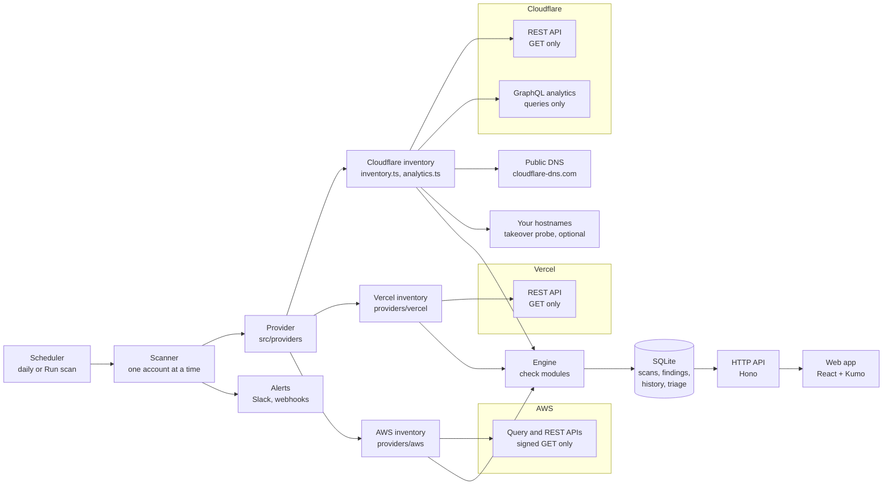

# How it works



## Providers

Every account belongs to one provider (Cloudflare, Vercel or AWS), recorded on the account. The scanner, the account
routes and the setup screen only talk to a provider through the `Provider` interface in `src/providers/types.ts`:
verify a credential, list the accounts it reaches, probe what it can read, and scan an account. `src/providers/index.ts`
lists them. Cloudflare's code predates providers and lives in `src/core`, wrapped by `src/providers/cloudflare.ts`;
Vercel's lives in `src/providers/vercel/` and AWS's in `src/providers/aws/`, and new providers get their own folder
the same way.

What the app says about a provider (its label, what it calls an account and a credential, the credential's fields,
its API host) comes from `PROVIDER_INFO` in `src/shared/providers.ts`, so screens and messages are worded for any
provider without comparing names.

What every provider shares: the check-module format and evaluator (`src/core/checks/define.ts`), the categories,
fingerprints and scoring (`src/core/engine.ts`), storage, triage, alerts and the whole web app. The dashboard's scope
is a set of accounts: all of them, an entity, one account, or any accounts ticked in the pickers (`s:<id>,<id>`),
optionally narrowed to one provider (`e:3@vercel`). Every scoped page follows it.

## A scan

The steps below are Cloudflare's; a Vercel scan reads teams, members, tokens, projects with their domains,
environment variable names and firewall, and the team's domains, certificates, drains and webhooks (about
four requests per project), then runs the same check, store and alert steps. An AWS scan reads IAM (the root
user, users with their keys and MFA, roles and policies), S3, CloudFront and Route 53 once, and security groups,
instances, EBS settings, VPCs, databases, load balancers, functions and GuardDuty in every enabled region
(about twelve requests per region, plus a few per user, bucket, load balancer and function). A region that
refuses the access key is skipped and recorded, rather than failing the scan. AWS has no client library here:
`src/providers/aws/sigv4.ts` signs each GET, and `xml.ts` reads the XML answers.

1. **Inventory.** For one account, Edgewatch reads everything the checks need into one typed `Inventory`:
   zones and their settings, DNS records, rulesets, certificates, members, tokens, Access, Gateway, Workers,
   R2, email routing and more, about 60 REST reads per account plus a few per zone. Every read is declared
   in `src/core/sources.ts` with the permission it needs; a read the token can't do is recorded as a coverage
   gap instead of failing the scan.
2. **Analytics.** GraphQL queries summarise the last 7 days of traffic: security actions, status codes,
   TLS versions, paths, leaked-credential checks, attack scores and more. Zones are batched by plan, since
   Free, Pro, Business and Enterprise expose different fields, and a field the plan can't read is dropped
   rather than failing the query.
3. **Checks.** Each module in `src/core/checks/` reads the inventory and reports pass or fail for every
   resource a check applies to. A check whose source couldn't be read is skipped, never passed.
4. **Store.** Findings get a stable fingerprint (check, account, zone, resource), so the same problem is
   the same finding from scan to scan. That's what carries triage, "first seen", "resolved" and "reopened"
   across scans.
5. **Alert.** New findings at or above the chosen severity, and findings that came back after being fixed,
   go to each entity's Slack channel or webhook.

The scanner never changes anything: REST calls are GET, GraphQL is POST but only ever queries, and
`test/integration.test.ts` (Cloudflare), `test/vercel.test.ts` (Vercel) and `test/aws.test.ts` (AWS) fail on any
other request. AWS services whose APIs only answer POST (CloudTrail, KMS, Config) are left unread for that reason.

## Checks that span providers

Some problems only show when a company's accounts on different providers are compared, for example a Cloudflare
DNS record that points at Vercel when no Vercel project in the company serves that hostname, or at a CloudFront
distribution none of its AWS accounts has. Each scan stores a few `links` in its snapshot (`ProviderLinks` in
`src/shared/api.ts`): Cloudflare, its DNS records that point at Vercel and at AWS, and the address of every A
record; Vercel, the domains its projects serve; AWS, its CloudFront domain names, load balancer names, buckets,
public addresses and account ID. A list is left out when its scan couldn't read all of it. When an account is
scanned, the scanner merges every list from the latest scans of the other accounts in the same entity and passes
them to the checks as `related`. A list is only used when every account of the provider that publishes it
(`LINK_PROVIDER`) supplied it: if one hasn't been scanned yet, or left it out, the merged list is incomplete, it is
set aside (`related.unknown` names it), and the checks that need it are skipped. An incomplete list is never
taken for "nothing there". These checks (IDs `XP-…`) never look outside the
entity, and are skipped when the entity has no scanned account on the other provider.

## Scoring

Every evaluation is pass or fail, weighted by severity (critical 10, high 6, medium 3, low 1). A category's
score is the weighted share of passing evaluations, and the posture score is the average of the categories,
so a category with thousands of DNS records can't drown out one with three notification checks. With several
accounts in view, the score is the average of the accounts' scores. Accepted risks and false positives don't
count against it.

## Triage and history

Triage (status, owner, due date, note, accepted-until) belongs to the fingerprint, not to a scan, so it
survives rescans. Every change is recorded in `triage_events`; together with which scans reported the
finding, that gives each finding its timeline and draws the lanes on the **Triaged** page. Accepted risk
reads as open again after its expiry date.

## Code layout

```
src/
  bin.ts, cli.ts        the edgewatch command: Node.js version check, then the command line
  main.ts               start(), which wires everything up
  core/                 Cloudflare's client, inventory and checks, and the engine every provider shares
    sources.ts          every Cloudflare data source: label, token permission, setup-screen probe
    cloudflare.ts       read-only API client: retries, rate limits, pagination, coverage
    inventory.ts        one scan's REST reads; analytics.ts holds the GraphQL reads
    checks/             check modules, one file per area, registered in checks/index.ts
    engine.ts           runs the modules, de-duplicates, fingerprints, scores
  providers/            the Provider interface, the registry, Cloudflare's adapter and the full check catalog
    vercel/             Vercel: read-only client, sources, inventory, checks, views, token checks
    aws/                AWS: signed read-only client, sources, inventory, checks, views, access key checks
  store/                SQLite: migrations (db.ts) and one repository per concern
  server/               Hono app: routes/, guards, validation, presentation
  shared/               API types and logic shared with the web app (no Node, no DOM)
web/src/                React app: routes.tsx lists every page
dev/mock/               mocked Cloudflare, Vercel and AWS APIs, for tests and `npm run dev -- --mock`
scripts/                dev runner, and the generator for docs/checks.md and docs/permissions.md
test/                   node:test suites
```

See [CONTRIBUTING.md](../CONTRIBUTING.md) for how to add a check.
