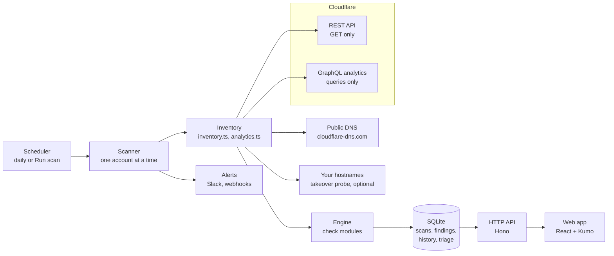

# How it works



## A scan

1. **Inventory.** For one account, Edgewatch reads everything the checks need into one typed `Inventory`:
   zones and their settings, DNS records, rulesets, certificates, members, tokens, Access, Gateway, Workers,
   R2, email routing and more, about 60 REST reads per account plus a few per zone. Every read is declared
   in `src/core/sources.ts` with the permission it needs; a read the token can't do is recorded as a coverage
   gap instead of failing the scan.
2. **Analytics.** GraphQL queries summarise the last 7 days of traffic: security actions, status codes,
   TLS versions, paths, leaked-credential checks, attack scores and more. Zones are batched by plan, since
   Free, Pro, Business and Enterprise expose different fields, and a field the plan can't read is dropped
   rather than failing the query.
3. **Checks.** Each module in `src/core/checks/` reads the inventory and reports pass or fail for every
   resource a check applies to. A check whose source couldn't be read is skipped, never passed.
4. **Store.** Findings get a stable fingerprint (check, account, zone, resource), so the same problem is
   the same finding from scan to scan. That's what carries triage, "first seen", "resolved" and "reopened"
   across scans.
5. **Alert.** New findings at or above the chosen severity, and findings that came back after being fixed,
   go to each entity's Slack channel or webhook.

The scanner never changes anything: REST calls are GET, GraphQL is POST but only ever queries, and
`test/integration.test.ts` fails on any other request.

## Scoring

Every evaluation is pass or fail, weighted by severity (critical 10, high 6, medium 3, low 1). A category's
score is the weighted share of passing evaluations, and the posture score is the average of the categories,
so a category with thousands of DNS records can't drown out one with three notification checks. With several
accounts in view, the score is the average of the accounts' scores. Accepted risks and false positives don't
count against it.

## Triage and history

Triage (status, owner, due date, note, accepted-until) belongs to the fingerprint, not to a scan, so it
survives rescans. Every change is recorded in `triage_events`; together with which scans reported the
finding, that gives each finding its timeline and draws the lanes on the **Triaged** page. Accepted risk
reads as open again after its expiry date.

## Code layout

```
src/
  bin.ts, cli.ts        the edgewatch command: Node.js version check, then the command line
  main.ts               start(), which wires everything up
  core/                 everything that talks to Cloudflare or judges what it found
    sources.ts          every data source: label, token permission, setup-screen probe
    cloudflare.ts       read-only API client: retries, rate limits, pagination, coverage
    inventory.ts        one scan's REST reads; analytics.ts holds the GraphQL reads
    checks/             check modules, one file per area, registered in checks/index.ts
    engine.ts           runs the modules, de-duplicates, fingerprints, scores
  store/                SQLite: migrations (db.ts) and one repository per concern
  server/               Hono app: routes/, guards, validation, presentation
  shared/               API types and logic shared with the web app (no Node, no DOM)
web/src/                React app: routes.tsx lists every page
dev/mock/               a mocked Cloudflare API, for tests and `npm run dev -- --mock`
scripts/                dev runner, and the generator for docs/checks.md and docs/permissions.md
test/                   node:test suites
```

See [CONTRIBUTING.md](../CONTRIBUTING.md) for how to add a check.
